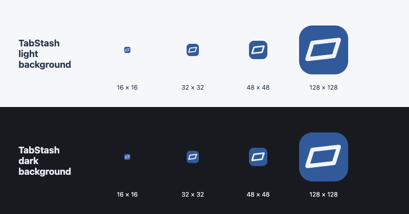

# TabStash icon

[icon.svg](icon.svg) is the editable source for the packaged extension and store icons. It uses the existing app brand colors (`#315a9a` blue and `#f0f5ff` light ink) and outlined tab motif, drawn as geometry without a font dependency. The icon stays blue regardless of the user's selected interface palette.

The store icon has a 96 × 96 rounded badge inside a 128 × 128 transparent canvas, following [Chrome's square-icon guidance](https://developer.chrome.com/docs/webstore/images#extension-icon). Smaller versions scale the same geometry and padding proportionally.

| PNG | Transparent padding per side |
| --- | --- |
| [16 × 16](../../extension/icons/16.png) | 2 px |
| [32 × 32](../../extension/icons/32.png) | 4 px |
| [48 × 48](../../extension/icons/48.png) | 6 px |
| [128 × 128](../../extension/icons/128.png) | 16 px |

## Regenerate

From the repository root, with development dependencies and Playwright Chromium installed:

```sh
npm ci
npx playwright install chromium
node scripts/render-icons.mjs
```

The script renders the SVG in an isolated headless browser, writes the four PNGs, and verifies their dimensions, RGBA format, and exact nontransparent pixel bounds. It also generates [icon-preview.png](../store/icon-preview.png) using the exported PNGs at native size on light and dark backgrounds. Inspect that sheet after changing the source. `PLAYWRIGHT_MODULE` and `CHROMIUM_PATH` can select an existing local runtime, as in the browser checks.

Only PNGs are used by the extension manifest. The SVG, generation script, and review sheet are development assets outside the packaged `extension/` directory.


