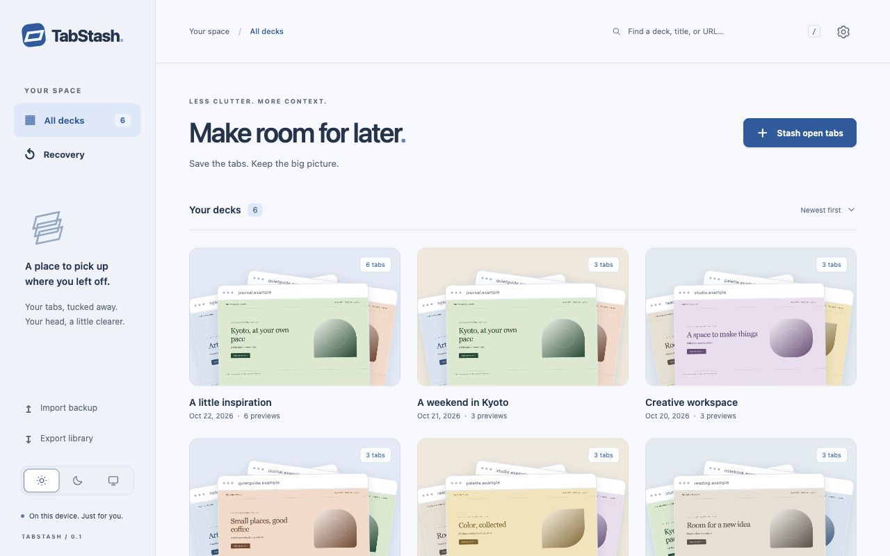
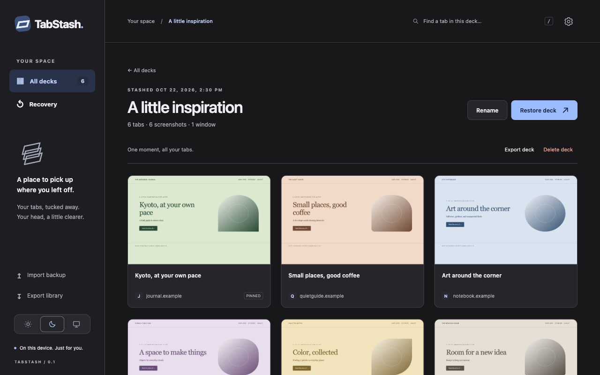
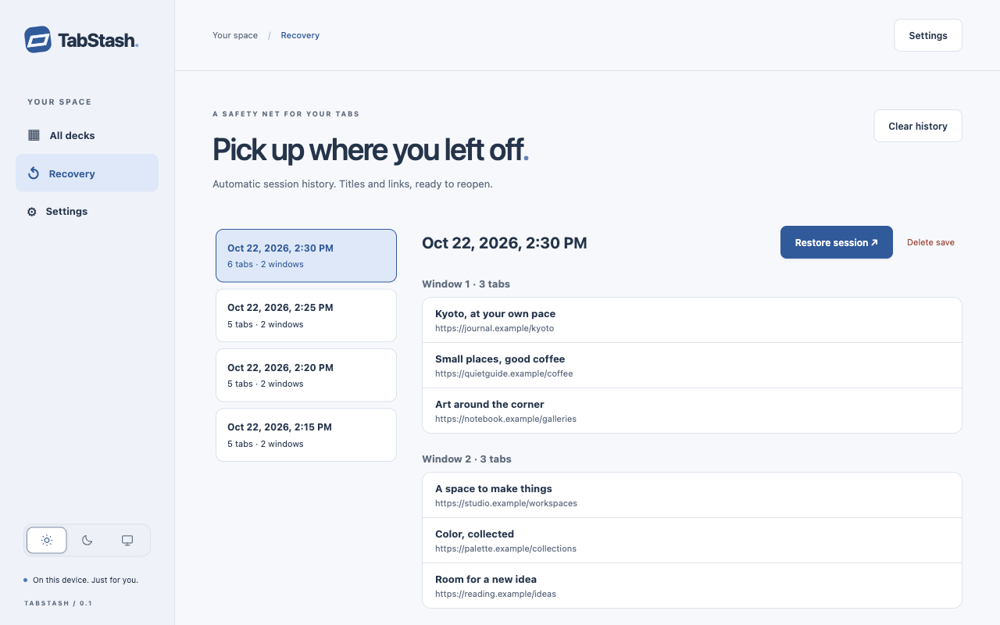
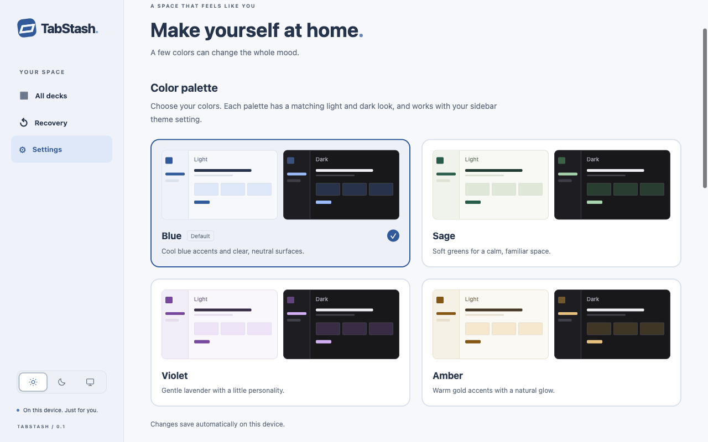

# Chrome Web Store listing draft

Prepared October 24, 2026, for TabStash 0.1.0 from `main` at `2c964ec`. This is reviewable submission material; nothing has been uploaded to the publisher dashboard or published.

## Listing fields

| Field | Value |
| --- | --- |
| Name (manifest) | TabStash |
| Short description (manifest) | A little space for your open tabs. Save, browse, and restore visual decks of screenshots. |
| Detailed description | Copy [description.txt](description.txt) as plain text. |
| Language | English |
| Suggested category | Functionality & UI — Google's category guidance explicitly includes tab managers. Verify the current dashboard label when submitting. |
| Homepage, if requested | https://github.com/janzd/tab-stash |
| Support URL | https://github.com/janzd/tab-stash/issues |
| Privacy policy URL | https://github.com/janzd/tab-stash/blob/main/PRIVACY.md |

The name and short description match the current manifest. Do not claim verified ownership of the GitHub domain. Publisher identity and distribution choices belong to the publisher setup step.

## Screenshot upload order

All four files are native 1280 × 800 PNG captures of the actual extension, without added borders, captions, or composited UI. They use fictional `.example` pages and sample saved-session data, not private browsing history.

1. [Library](images/library.png): visual decks in light mode.
2. [Open deck](images/deck-dark.png): screenshot cards, search, and restore controls in dark mode.
3. [Recovery history](images/recovery.png): saved titles and links grouped by window, without screenshots.
4. [Appearance settings](images/settings.png): matching light/dark color palettes and the sidebar theme control.









The existing README images remain separate because they use a taller viewport. The store images are freshly rendered, not stretched or cropped from those files.

## Other artwork

The current packaged icon is [extension/icons/128.png](../../extension/icons/128.png), a 128 × 128 PNG. Review it before final packaging: its green rounded background reaches the image edges, while Google's square-icon guidance calls for a 96 × 96 mark inside transparent padding. This PR does not redesign the existing icon.

The small promotional tile (440 × 280), marquee tile (1400 × 560), and promotional video are optional and are not included in this set. The four screenshots cover the main product features; optional promotional artwork can follow separately.

## Reproduce the screenshots

From the repository root:

```sh
npm ci
npx playwright install chromium
node scripts/capture-store.mjs
```

Requires a desktop session because extension capture uses headed Chromium. The script supports `PLAYWRIGHT_MODULE` and `CHROMIUM_PATH`, like the browser checks, for an existing local runtime.

The script copies the extension into a temporary directory, pregrants screenshot access only in that copy, creates an isolated browser profile, and intercepts fictional `.example` pages locally. It captures six sample pages through the normal stash action, then seeds named sample decks and recovery history. Only `docs/store/images/` is overwritten; your normal browser profile is not used. Temporary files are removed after the browser closes.

Checks require six captured screenshots, six decks, six cards in the open deck, two recovery windows, no page errors, and 1280 × 800 RGB PNG output. Font rendering can vary by OS; inspect regenerated images before committing them. No UI is hidden or restyled for these captures.

## Before submission

- Resolve the security and data-category questions in [privacy declarations](../store-privacy-declarations.md).
- Decide whether experimental previews ship in the first release. If removed, remove the experimental-preview paragraph from the description and update the policy and permission notes together.
- Finish the icon review, final package validation, and publisher setup.
- Compare the final listing and screenshots with the package actually being submitted. These materials do not establish store approval.

## Sources checked

- [Listing fields and required assets](https://developer.chrome.com/docs/webstore/cws-dashboard-listing): store icon and at least one screenshot are required; up to five screenshots are supported.
- [Supplying images](https://developer.chrome.com/docs/webstore/images): screenshot dimensions, icon padding, and optional promotional artwork.
- [Category guidance](https://developer.chrome.com/docs/webstore/best-practices#choose_your_extensions_category_well): Functionality & UI includes tab managers.
